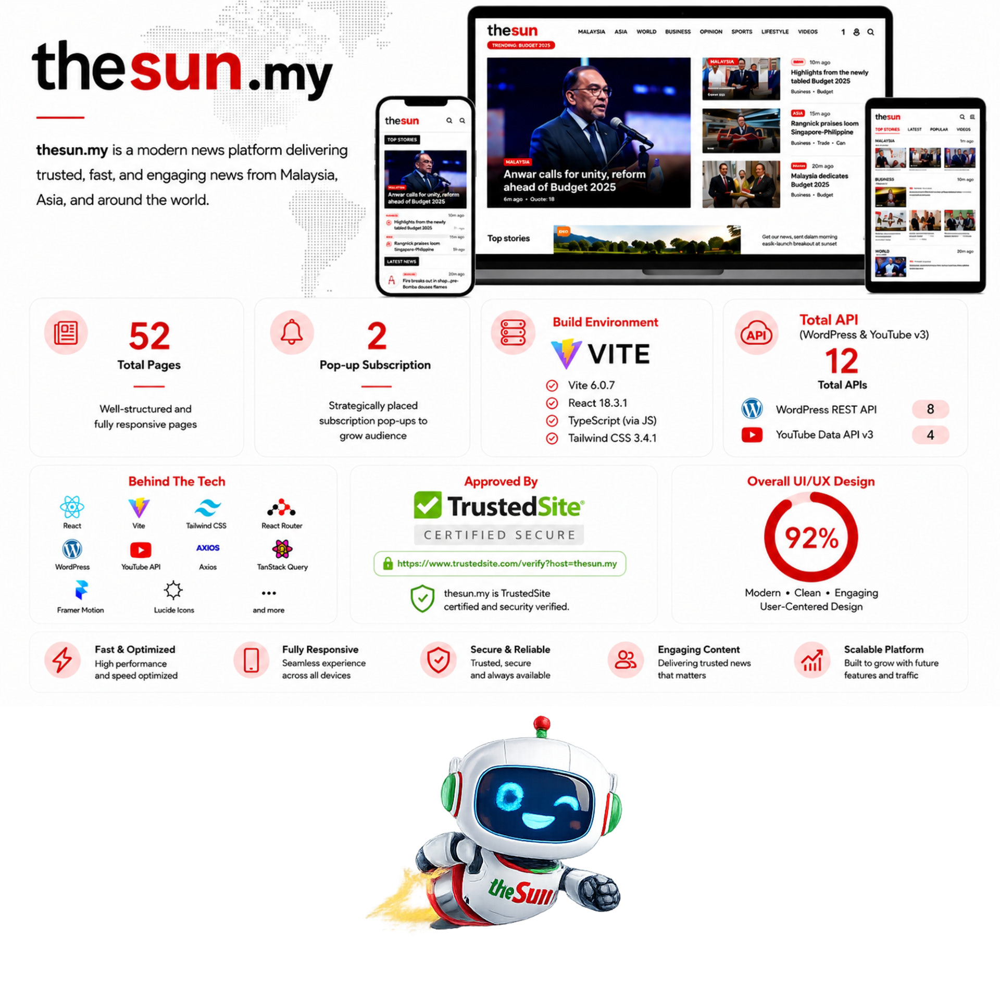

<a id="readme-top"></a>

<div align="center">

<h1></h1>

### News that matters. A fresh digital experience.

**A responsive news platform powered by React, Vite and WordPress.**


<a href="https://github.com/sureshapps/The-Sun-Malaysia"></a>
<a href="https://github.com/sureshapps/The-Sun-Malaysia#-quick-start"></a>
<a href="https://github.com/sureshapps/The-Sun-Malaysia#-deployment"></a>
<a href="https://github.com/sureshapps/The-Sun-Malaysia#-the-vite-migration"></a>


**🇲🇾 Malaysian stories · 🌏 Global perspectives · ⚡ A modern reading experience**

</div>

---

## 🔴 Built for the way you read

THE SUN MALAYSIA brings headlines, category archives and full articles into a single-page application. WordPress supplies the editorial content, React Router handles navigation, and SWR shares cached requests across the news feed, ticker and sidebar widgets.

| Experience | What readers get |
| :--- | :--- |
| 🏠 Homepage | Featured hero, Top Stories sidebar, Editor’s Picks and breaking-news ticker |
| 🗂️ Category archives | Featured story, article grid and API-driven pagination totals |
| 📰 Article pages | Full content, breadcrumbs, related sidebar widgets and share buttons |
| 🔎 Discovery | Search, Latest news and infinite scrolling on Latest |
| 📱 Responsive interface | Layouts designed for desktop, tablet and mobile |
| ⚡ Shared data | SWR caching and deduplication for matching API requests |
| 🧭 Navigation | Client-side routing, scroll reset and page-specific titles |
| ✉️ Reader engagement | Newsletter interface and retained subscription features |

> Migration checks in the original project notes reported working homepage, category and article flows, including direct article links and shared SWR requests. Live article counts change with the API.

## 🎨 The Sun in pictures

<table>
  <tr>
    <td align="center" width="50%">
      <br>
      <strong>One platform. Every screen.</strong><br>
      A visual overview of the digital experience.
    </td>
    <td align="center" width="50%">
      <br>
      <strong>A brand full of personality.</strong><br>
      Editorial, community and promotional touchpoints.
    </td>
  </tr>
</table>

<details>
<summary><strong>🖼️ View the full-page promotional showcase</strong></summary>

<p align="center">
  
</p>

</details>

> The four images are supplied promotional artwork. Embedded page counts, ratings, certifications and technology labels belong to that artwork; they are not independent verification of this repository. The stack below reflects the inspected project files.

## 🧩 Technology

| Layer | Technology | Purpose |
| :--- | :--- | :--- |
| UI | React 18.3.1 | Component-based application |
| Development & build | Vite 6.0.7 | Development server and static production bundle |
| Routing | React Router 7.1.5 | Browser-based navigation |
| Data fetching | SWR 2.3.8 | Cache, revalidation and request deduplication |
| Styling | Tailwind CSS 3.4.1 | Design tokens and responsive styling |
| Components | shadcn UI / Radix UI | Reusable interface primitives |
| Editorial API | WordPress REST API | Articles, categories, tags and authors |
| Video integration | YouTube Data API v3 | Video data using the configured API key |
| Metadata | `src/lib/useSeo.js` | Client-side title, Open Graph and JSON-LD updates |

## 🚀 Quick start

### 1. Get the project

Install Node.js 22 LTS and Yarn Classic 1.22.22, then run:

```sh
git clone https://github.com/sureshapps/The-Sun-Malaysia.git
cd The-Sun-Malaysia
yarn install --frozen-lockfile
```

### 2. Configure the environment

Copy `.env.example` to `.env`. In Windows PowerShell:

```powershell
Copy-Item .env.example .env
```

On macOS or Linux:

```sh
cp .env.example .env
```

Set the value needed for video features:

```dotenv
VITE_YOUTUBE_API_KEY=your_youtube_data_api_v3_key_here
```

The WordPress base URL is configured in `src/lib/wp.js` as `https://thesun.my/wp-json/wp/v2`. Browser requests require that API to be available and permit cross-origin access.

`VITE_` values are included in the browser bundle. Restrict the YouTube key to the required API and allowed website referrers; keep private credentials out of client-side configuration. Restart the development server after changing `.env`.

### 3. Start reading

```sh
yarn dev
```

Open **[http://localhost:3000](http://localhost:3000)**. Port 3000 must be free because this project enables `strictPort`.

| Command | Action |
| :--- | :--- |
| `yarn dev` | Start the Vite development server on port 3000 |
| `yarn build` | Generate the production site in `dist/` |
| `yarn preview` | Preview the production build locally on port 3000 |
| `yarn start` | Alias for local Vite preview in this project |

Use one package manager consistently. This project declares Yarn Classic in `package.json`.

## 🧭 Pages and routes

| Page | Migration conversation | Current local source |
| :--- | :--- | :--- |
| Homepage | `/` | `/` |
| Category | `/category/business` | `/:slug`, such as `/business` when that category exists |
| Article | `/article/[slug]` | `/:category/:slug`, using the article’s matching category |
| Search | Retained | `/search` |
| Latest | Retained, with infinite scroll | `/latest` |
| Videos | Video integration | `/videos` |

The category and article URL patterns have evolved since the migration notes. `src/lib/routes.js` and `src/App.jsx` define the current routes. Use a real article link from the feed when checking direct navigation.

## 🟣 The Vite migration

The application moved from Next.js to a Vite SPA while preserving its visual identity and reader-facing features.

| Area | Migration result |
| :--- | :--- |
| Framework | Removed Next.js and the Next App Router |
| Rendering | Replaced server components with a browser-rendered React application |
| Navigation | Added React Router v7 |
| Data | Added SWR and browser-side WordPress helpers |
| Build | Added Vite 6; `yarn dev` launches Vite on port 3000 |
| Structure | Organized application code under `src/components`, `src/lib` and `src/pages` |
| Removed files | Next.js `app/` routing tree, `next.config.js` and `app/api/...` handlers |
| Preserved | Design system, shadcn UI, Tailwind tokens, branding, search, ticker, sharing, newsletter and Latest infinite scroll |

Metadata is updated in the browser. Search engines and social crawlers that do not execute JavaScript may need prerendering or another server-rendered metadata solution.

## 📁 Project structure

```text
The-Sun-Malaysia/
├── README.md
├── assets/readme/             # These four promotional images
├── public/                   # Static app assets
├── index.html                # Vite SPA entry
├── vite.config.js            # @ alias → ./src; port 3000
├── package.json
├── yarn.lock
├── .env.example
├── vercel.json               # SPA fallback rewrite
├── tailwind.config.js
├── jsconfig.json
├── components.json
└── src/
    ├── main.jsx              # React, BrowserRouter and SWR setup
    ├── App.jsx               # Routes and scroll handling
    ├── index.css
    ├── lib/
    │   ├── wp.js             # WordPress API helpers
    │   ├── useSeo.js         # Browser metadata updates
    │   ├── routes.js         # Registered route paths
    │   └── utils.js
    ├── components/
    │   ├── ui/               # shadcn UI components
    │   └── site/             # Header, footer, ticker, cards and widgets
    └── pages/                # Home, category, article and other pages
```

## 🌍 Deployment

### Build and check locally

```sh
yarn build
yarn preview
```

Open [http://localhost:3000](http://localhost:3000). `dist/` contains the static site to deploy. Vite preview is for local checking; production hosting should serve the built files. See the [Vite deployment guide](https://vite.dev/guide/static-deploy.html).

### Deploy to Vercel

1. Import the GitHub repository into Vercel.
2. Choose the **Vite** framework preset.
3. Set the install command to `yarn install --frozen-lockfile`, build command to `yarn build`, and output directory to `dist`.
4. Add `VITE_YOUTUBE_API_KEY` to the relevant deployment environments before building.
5. Keep the root `vercel.json` SPA rewrite:

```json
{
  "rewrites": [
    { "source": "/(.*)", "destination": "/index.html" }
  ]
}
```

The fallback lets React Router handle direct links and browser refreshes. See [Vercel’s Vite documentation](https://vercel.com/docs/frameworks/frontend/vite).

### Other static hosts

Publish `dist/` and configure the host to serve existing static files normally, then fall back to `index.html` for application routes. For a subdirectory deployment, align Vite’s `base` and React Router’s `basename` with that path. GitHub Pages also needs a separate deep-link fallback strategy because it does not provide standard SPA rewrites.

After deployment, check the homepage, a category and a real article; refresh the article URL directly; confirm that images and API content load; and check the browser title after navigation. Environment changes require a new build.

## 🛠️ Troubleshooting

| Symptom | What to check |
| :--- | :--- |
| Port 3000 is busy | Stop the other process or change the project’s configured port |
| Refreshing an article gives a host 404 | Add the SPA fallback to `index.html` |
| No articles or missing pagination totals | Check the WordPress response, CORS and exposure of pagination headers |
| Videos do not load | Check the YouTube key, API restrictions and quota; rebuild after changes |
| Old `/article/...` or `/category/...` links fail | Use the current route patterns or add explicit legacy redirects |
| Social preview is generic | Client-side metadata may need prerendering for the crawler |

## 🤝 Contributing and credits

Keep changes focused, follow the existing design tokens and component patterns, and run `yarn build` before submitting a pull request. Include screenshots for visual changes and check mobile layouts and direct article links.

Promotional images were supplied for this README. The Sun name, logos, editorial content and artwork remain subject to their respective owners’ rights. This README does not grant a software or media license; consult the repository’s license, if provided, before reuse.

---

<div align="center">

**☀️ THE SUN MALAYSIA**  
**Stay informed. Stay connected.**

[Back to top](#readme-top)

</div>
